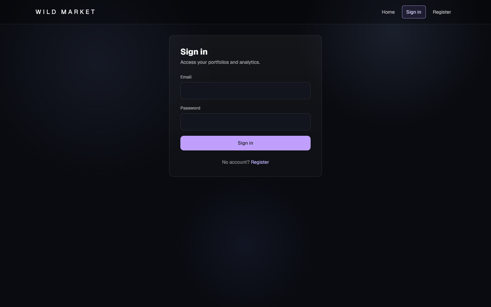
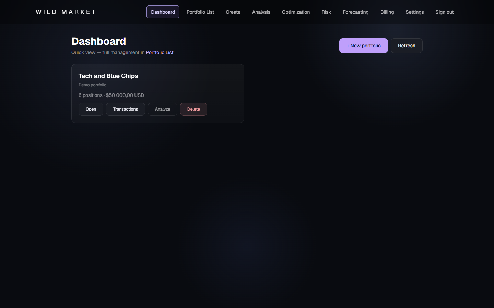
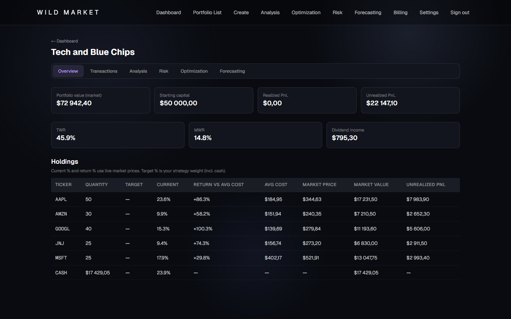
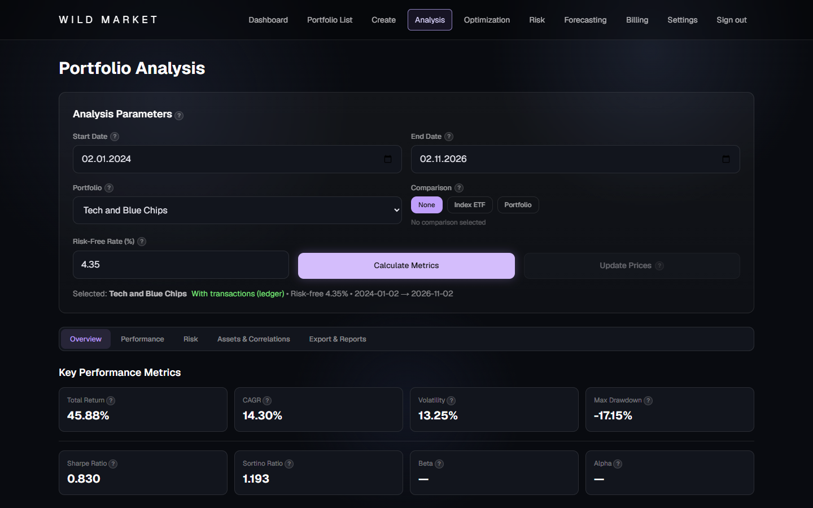
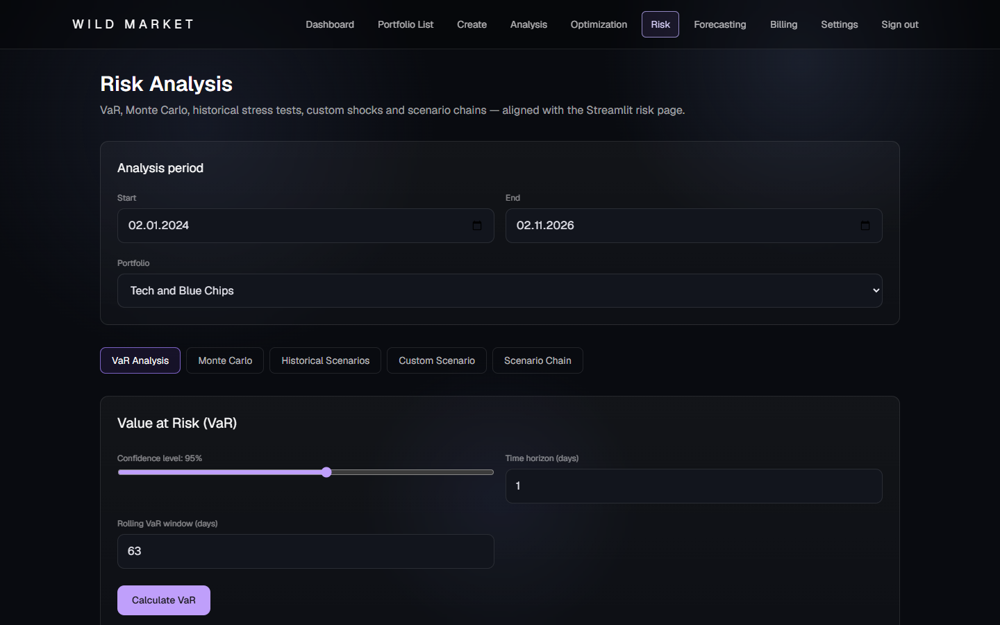
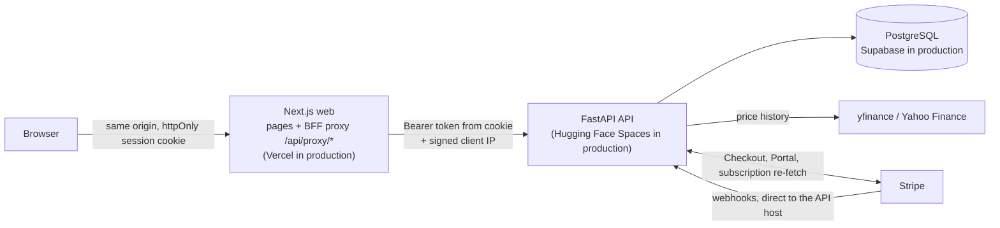

# Portfolio Management Pro

A web app for tracking investment portfolios: positions or a full transaction ledger, performance and risk analytics, portfolio optimization and price forecasting, with Stripe subscriptions for the Pro plan.

The browser talks only to a Next.js app, which proxies to a FastAPI service backed by PostgreSQL. Market data comes from yfinance. Billing runs on Stripe.

<p align="center">
  <a href="https://www.python.org/"></a>
  <a href="https://github.com/imnotkeril/Portfolio_Management_Pro/actions/workflows/ci.yml"></a>
  <a href="https://codecov.io/gh/imnotkeril/Portfolio_Management_Pro"></a>
  <a href="LICENSE"></a>
  <a href="https://fastapi.tiangolo.com/"></a>
  <a href="https://nextjs.org/"></a>
</p>

## Contents

- [Screenshots](#screenshots)
- [Features](#features)
- [Architecture](#architecture)
- [Stack](#stack)
- [Quick start](#quick-start)
- [Configuration](#configuration)
- [Testing and checks](#testing-and-checks)
- [Project structure](#project-structure)
- [Deployment](#deployment)
- [Security](#security)
- [Known limitations](#known-limitations)
- [Documentation](#documentation)
- [Contributing](#contributing)
- [License](#license)

## Screenshots

All captures are from the Next.js app at 1440x900, using a demo account and a demo portfolio with made-up transaction prices.

<p align="center">
  
</p>

<p align="center">
  
</p>

<p align="center">
  
</p>

<p align="center">
  
</p>

<p align="center">
  
</p>

## Features

**Portfolios and transactions**

- Create portfolios from text, a CSV file, manual entry, or a template (the four methods on `/create`).
- Ledger modes per portfolio: `buy_hold` (positions only) or `transactions` (full ledger).
- Transactions: BUY, SELL, DEPOSIT, WITHDRAWAL, plus dividend and split sync endpoints.
- Overview with market value, realized and unrealized PnL, TWR/MWR, dividend income and holdings.
- Target weights and a rebalance preview/execute flow (`/portfolios/{id}/rebalance/*`).

**Analysis**

- Analysis page with five tabs: Overview, Performance, Risk, Assets & Correlations, Export & Reports.
- Benchmark comparison against an index ETF or another portfolio.

**Optimization (Pro)**

- Ten methods in the UI: mean-variance, Black-Litterman, risk parity, HRP, CVaR optimization, mean-CVaR, robust, max diversification, min correlation, inverse correlation (`core/optimization_engine/`).
- Efficient frontier and an out-of-sample option with a training ratio.

**Risk**

- Value at Risk by historical, parametric and Monte Carlo methods.
- Monte Carlo simulation, historical stress tests, custom shock scenarios and scenario chains (`/risk/*`).

**Forecasting (Pro)**

- Classical (ARIMA, GARCH), machine learning (random forest, SVM, XGBoost), deep learning (LSTM, TCN, SSA-MAEMD-TCN) and simple (Prophet) model families.
- Forecasts for a single asset, a portfolio, or a batch (`/forecasting/*`).
- The full model set needs the heavy dependencies in `requirements.txt`; see [Quick start](#quick-start).

**Billing**

- Free plan: one portfolio. Pro: optimization and forecasting, and more than one portfolio.
- Stripe Checkout for subscriptions, Stripe Customer Portal, and a signature-checked webhook (`/stripe/webhook`) that updates the plan.

## Architecture



```text
browser ──▶ Next.js (Vercel)  ──▶ FastAPI (HF Spaces) ──▶ PostgreSQL (Supabase)
             BFF /api/proxy        │
             (allowlisted paths,   ├──▶ yfinance (prices)
              cookie → Bearer)     └──▶ Stripe (checkout, portal; webhooks come straight to the API)
```

- **BFF proxy.** The Next.js route `frontend/src/app/api/proxy/[...path]/route.ts` forwards only allowlisted first path segments (`frontend/src/lib/proxy-path.ts`) to the API. The JWT lives in an httpOnly cookie and is sent as a Bearer token. Anything outside the allowlist returns 404.
- **Client IP.** The BFF reads the visitor IP from a platform header and sends it to the API with an HMAC signature (`CLIENT_IP_SIGNING_KEY`). The API uses it for rate limits only if the signature verifies and is fresh.
- **Layers.** `core/` holds framework-agnostic calculations and repositories; `services/` orchestrates them; `api/` exposes HTTP routes; `models/` and `database/` hold SQLAlchemy models and Alembic migrations.
- **Stripe webhooks** go to `https://<api-host>/stripe/webhook`. The BFF does not proxy that path. Each event re-fetches the subscription from Stripe, so event order and event bodies are not trusted for entitlement.

## Stack

| Area | Technology |
|------|------------|
| API | Python 3.11, FastAPI, Pydantic v2, pydantic-settings, Uvicorn |
| Data | PostgreSQL 16 (Docker) or Supabase Postgres (production), SQLAlchemy 2, Alembic, psycopg2 |
| Analytics | NumPy, pandas, SciPy, statsmodels, CVXPY, scikit-learn, XGBoost, TensorFlow, Prophet, arch, pmdarima |
| Market data | yfinance |
| Auth | JWT (python-jose), bcrypt via passlib, `limits` for rate limiting |
| Billing | Stripe Python SDK (Checkout, Customer Portal, webhooks) |
| Web | Next.js 16, React 19, TypeScript, Tailwind CSS 4, Recharts, ESLint |
| Containers and hosting | Docker, Docker Compose; Vercel (web), Hugging Face Spaces (API), Supabase (database) |
| CI | GitHub Actions: Ruff, Black, isort, Mypy, pytest with `core/` coverage gate, ESLint, `tsc`, `next build` |

## Quick start

Requirements: Docker with Compose v2 for the full stack. For running the API and web on the host: Python 3.11, Node.js 20+, and Docker for PostgreSQL. The repository has no SQLite option (see the note below).

### Option A: Docker Compose (full stack)

```bash
docker compose up --build
```

Open:

- Web app: <http://localhost:3000>
- API health: <http://localhost:8000/health>

The first build is slow and large: `Dockerfile.api` installs the full `requirements.txt` (TensorFlow, Prophet, ...), and the API image is about 6 GB.

Compose starts three services: `postgres` (PostgreSQL 16, user, password and database `portfolio`), `api` (runs `alembic upgrade head` and then Uvicorn), and `web` (Next.js standalone build). The host ports are fixed in `docker-compose.yml`: 3000, 8000 and 5432. If a port is taken, change the host side of that `ports:` entry.

Stripe values are read from a `.env` file in the project root by Compose interpolation (`STRIPE_SECRET_KEY`, `STRIPE_WEBHOOK_SECRET`, `STRIPE_PRICE_ID_PRO`, `BILLING_ENFORCEMENT`). Without them, billing stays unconfigured and everything else works.

### Option B: API and web on the host

```bash
python -m venv .venv
source .venv/bin/activate            # Windows PowerShell: .venv\Scripts\Activate.ps1
pip install -c requirements.lock.txt -r requirements.txt   # full set: TensorFlow, Prophet, Playwright, ...
cp .env.example .env                 # DATABASE_URL already points at localhost:5432
docker compose up -d postgres        # only the postgres service
alembic upgrade head
uvicorn api.main:app --reload --host 127.0.0.1 --port 8000
```

The full set is large. For a lighter install use `pip install -c requirements.lock.txt -r requirements-deploy.txt` instead. It leaves out TensorFlow, Prophet, pmdarima, EMD-signal and Playwright, so the matching forecasting models and the Playwright PDF path are unavailable; the rest of the API works.

In a second terminal:

```bash
cd frontend
npm install
npm run dev
```

Open <http://localhost:3000>. With no environment variables the web app proxies to `http://localhost:8000`. To change that, set `API_INTERNAL_URL` (see [Configuration](#configuration)).

### SQLite

`DATABASE_URL=sqlite:///./data/wmc.db` is the default in `config/settings.py`, and the tests use SQLite. The API does not boot on SQLite at present: on startup, `init_db()` fails with `sqlite3.OperationalError: database is locked` while creating the system user's subscription. Use PostgreSQL (Option A or B) until that is fixed.

### API docs

In `development` the OpenAPI schema is at `/openapi.json`, Swagger UI at `/docs` and ReDoc at `/redoc`. In `production` all three are disabled. `GET /llms.txt` (public, in every environment) lists all 52 operations as Markdown; it is generated by `python scripts/gen_llms_txt.py` and checked against the live routes by `tests/unit/test_llms_txt.py`.

## Configuration

Copy `.env.example` to `.env` for local runs. Every variable is optional in development because `config/settings.py` has defaults. Compose passes some values itself (see `docker-compose.yml`). Never commit real values.

### API (`.env`, Compose `api` service, Hugging Face Spaces secrets)

| Variable | Default | Read by | Meaning |
|----------|---------|---------|---------|
| `ENVIRONMENT` | `development` | `config/settings.py` | `production` enables the boot guards below, hides the API docs and sends HSTS. Any other value (including a typo) behaves as development. |
| `DEBUG` | `false` | `config/settings.py` | Debug flag. Keep `false`. |
| `JWT_SECRET` | `change-me-in-production` | `config/settings.py` | Signing key for access tokens. In production: must not be the default and must be at least 32 characters. |
| `JWT_ALGORITHM` | `HS256` | `config/settings.py` | JWT algorithm. |
| `ACCESS_TOKEN_EXPIRE_MINUTES` | `1440` | `config/settings.py` | Token lifetime in minutes. |
| `AUTH_DISABLED` | `false` | `config/settings.py` | Skips authentication for local development. Refused when `ENVIRONMENT=production`. |
| `DATABASE_URL` | `sqlite:///./data/wmc.db` | `config/settings.py`, `database/migrations/env.py` | SQLAlchemy URL. Use `postgresql+psycopg2://...`. SQLite does not boot (see above). |
| `DATABASE_ECHO` | `false` | `config/settings.py` | Log SQL statements. |
| `RATE_LIMIT_ENABLED` | `true` | `config/settings.py` | IP-based limits on auth and public endpoints. Tests turn it off. |
| `CLIENT_IP_SIGNING_KEY` | unset | `config/settings.py` | Shared secret with the web app. A signed `X-Client-IP` is trusted only if the HMAC verifies. Production: required, at least 32 characters (the API refuses to boot without it). Set the same value on the web app. |
| `CLIENT_IP_MAX_AGE_SECONDS` | `60` | `config/settings.py` | Maximum age of a signed client IP. |
| `TRUSTED_PROXY_COUNT` | `0` | `config/settings.py` | Fallback when no valid signed IP: take the Nth entry from the right of `X-Forwarded-For` (0 = ignore the header). Must match the real proxy chain. Keep `0` when the signing key is set. |
| `CORS_ORIGINS` | empty | `api/main.py` (`os.getenv`) | Extra allowed browser origins, comma-separated. `FRONTEND_URL` and `http://localhost:3000` are always allowed. |
| `FRONTEND_URL` | `http://localhost:3000` | `config/settings.py`, `api/main.py` | Web app URL, used for Stripe return URLs and CORS. No trailing slash. |
| `PRICE_CACHE_DIR` | `data/cache/prices` | `config/settings.py` | Directory for the price cache. |
| `LOG_LEVEL` | `INFO` | `config/settings.py` | Log level. |
| `LOG_FILE` | `logs/app.log` | `config/settings.py` | Log file path. |
| `STRIPE_SECRET_KEY` | unset | `config/settings.py` | Stripe secret key (`sk_test_...` for test mode). Checkout and the portal need it. |
| `STRIPE_WEBHOOK_SECRET` | unset | `config/settings.py` | Signing secret of the webhook endpoint (`whsec_...`). Without it the webhook returns 503. |
| `STRIPE_PRICE_ID_PRO` | unset | `config/settings.py` | Price for the Pro plan (`price_...`). |
| `BILLING_ENFORCEMENT` | `true` | `config/settings.py` | Enforces plan limits. `false` gives every user Pro features; never set it in production. |
| `PORT` | `7860` | `Dockerfile` (`CMD`) | Listen port of the Hugging Face Spaces image. Not read by the Python code. |

`.env.example` also lists the names below. No code reads them yet, so setting them has no effect. They are marked `[unused]` there:

`APP_NAME`, `APP_VERSION`, `YAHOO_FINANCE_ENABLED`, `ALPHA_VANTAGE_API_KEY`, `IEX_CLOUD_API_KEY`, `CACHE_ENABLED`, `CACHE_TTL_SECONDS`, `MAX_WORKERS`, `CALCULATION_TIMEOUT_SECONDS`, `RISK_FREE_RATE`, `MAX_PORTFOLIO_POSITIONS`, `MIN_POSITION_WEIGHT`, `MAX_POSITION_WEIGHT`.

### Web app (`frontend/`, Vercel project settings, Compose `web` service)

| Variable | Default | Read by | Meaning |
|----------|---------|---------|---------|
| `API_INTERNAL_URL` | falls back to `NEXT_PUBLIC_API_URL`, then `http://localhost:8000` | `frontend/src/lib/auth-cookie.ts` (server side) | Base URL of the API that the BFF proxy calls. Compose sets `http://api:8000`. |
| `NEXT_PUBLIC_API_URL` | `http://localhost:8000` | `frontend/Dockerfile` build argument, `auth-cookie.ts` fallback | Public API base, baked in at build time. Redeploy after changing it. Never put a secret here. |
| `COOKIE_SECURE` | `false` | `frontend/src/lib/auth-cookie.ts` | `true` adds `Secure` to the session cookie. Set it to `true` behind HTTPS (production). |
| `CLIENT_IP_SIGNING_KEY` | unset | `frontend/src/lib/client-ip.ts` | Same value as on the API. Signs the visitor IP sent to the API. |
| `CLIENT_IP_TRUSTED_HEADER` | unset (on Vercel: `x-vercel-forwarded-for`) | `frontend/src/lib/client-ip.ts` | Header the hosting platform sets with the visitor IP. Use it on hosts other than Vercel. The platform must overwrite it so clients cannot forge it. |
| `VERCEL` | set by Vercel | `frontend/src/lib/client-ip.ts` | Set automatically by Vercel. Do not set it yourself. |

### Client IP settings in production

The web app sends the visitor IP to the API only in signed form. The API accepts `X-Client-IP` only when `CLIENT_IP_SIGNING_KEY` matches, the signature verifies, and the timestamp is within `CLIENT_IP_MAX_AGE_SECONDS`. Recommended: set the same signing key on both sides and keep `TRUSTED_PROXY_COUNT=0`. Setting `TRUSTED_PROXY_COUNT` above the real number of proxies lets direct API callers choose their own IP.

Login limits: 20 requests per minute per IP across `/auth/login` and `/auth/login/json`, and 5 failed logins per 15 minutes per (email, IP) pair. A successful login clears that pair's counter. After 5 failures for one email from any IP, failed attempts are delayed by up to 2 seconds. Limiter state is in process memory (see [Known limitations](#known-limitations)).

## Testing and checks

Backend (from the repository root, with the venv from Option B active and the dev tools installed):

```bash
pip install -c requirements.lock.txt -r requirements-dev.txt
pytest                                   # full suite; pytest.ini applies the core/ coverage gate (70%)
pytest --cov=core --cov-config=.coveragerc --cov-report=html --cov-report=term-missing
pytest tests/unit/ --no-cov              # subsets need --no-cov, otherwise the 70% gate fails the partial run
pytest tests/integration/ --no-cov
pytest tests/performance/ --no-cov
```

Lint, format and types (the same commands CI runs):

```bash
ruff check .
black --check .
isort --check-only .                     # if the venv is inside the repo, use: isort --check-only --skip .venv .
mypy core/ services/ api/ config/ models/ database/
pre-commit install                       # optional: git hooks from .pre-commit-config.yaml
```

Frontend (from `frontend/`):

```bash
npm run lint
npx tsc --noEmit
npm run build
```


## Project structure

```text
Portfolio_Management_Pro/
├── api/                   FastAPI app: main.py (routes), routers/ (auth, billing), schemas/,
│                          dependencies.py, rate_limit.py, security_headers.py
├── core/                  Framework-agnostic business logic
│   ├── analytics_engine/
│   ├── auth/              password hashing, JWT
│   ├── data_manager/      repositories (portfolios, transactions, users, subscriptions), price manager
│   ├── forecasting_engine/  classical/, ml/, deep_learning/, simple/
│   ├── optimization_engine/
│   ├── risk_engine/       VaR, Monte Carlo, stress tests
│   └── scenario_engine/
├── services/              Orchestration over core/ (portfolio, ledger, optimization, risk, forecasting,
│                          rebalance, billing/ with plans and webhook service)
├── models/                SQLAlchemy models (users, portfolios, positions, transactions, subscriptions, ...)
├── database/              session.py, migrate.py, migrations/ (Alembic)
├── config/                settings.py (environment variables), logging, constants
├── frontend/              Next.js 16 app: src/app (pages and the BFF route under api/proxy),
│                          src/components, src/lib (proxy allowlist, cookie, client IP)
├── tests/                 unit/, integration/, performance/, conftest.py
├── scripts/               Stripe CLI listener (PowerShell), profiling helper, git history helpers
├── assets/screenshots/    README screenshots
├── Dockerfile             Hugging Face Spaces image for the API (port 7860, runs migrations on boot)
├── Dockerfile.api         Compose image for the API (port 8000)
├── docker-compose.yml     postgres + api + web
├── requirements*.txt      requirements.txt (full), requirements-deploy.txt (slim), requirements-dev.txt,
│                          requirements.lock.txt (pins)
├── alembic.ini
├── pyproject.toml         Ruff, Black, isort, Mypy settings
└── pytest.ini, .coveragerc
```

## Deployment

The production setup:

- **Web:** Vercel, project root `frontend/`. Set the web variables above, with `COOKIE_SECURE=true` and `CLIENT_IP_SIGNING_KEY` equal to the API's.
- **API:** Hugging Face Spaces with the Docker SDK, using the root `Dockerfile` (port 7860). Runs `alembic upgrade head` on every boot, then Uvicorn with one process. Set `ENVIRONMENT=production`, a strong `JWT_SECRET`, `AUTH_DISABLED=false`, and the Stripe secrets as Space secrets. Keep one replica (see below).
- **Database:** Supabase Postgres. Use the direct or session connection string with `sslmode=require` in `DATABASE_URL`. Take a dump before deploys that include migrations.
- **Stripe:** the webhook endpoint is the API host (`https://<api-host>/stripe/webhook`), not the web host. It sends `checkout.session.completed`, `invoice.paid`, `customer.subscription.updated` and `customer.subscription.deleted`.

Release steps and owner actions are in [OWNER_GUIDE.md](OWNER_GUIDE.md). Verify a deployment with `GET /health` on the API, `/login` on the web app and `GET /llms.txt` on the API.

## Security

Production guards in `config/settings.py` (the API refuses to start if they fail):

- `AUTH_DISABLED=true` is refused.
- The default `JWT_SECRET` and a secret shorter than 32 characters are refused.
- A missing or shorter than 32 characters `CLIENT_IP_SIGNING_KEY` is refused.

Other protections, with tests in `tests/`:

- Passwords are hashed; the register response never includes a hash. Registration and login have IP limits and per-(email, IP) failure limits.
- Access tokens are checked for signature, expiry and the user's active status. Tampered, expired and `alg=none` tokens are rejected.
- Portfolio and transaction routes are scoped to the owner; other users' IDs get 404.
- Stripe webhooks: the signature is verified on the raw body, delivery ids are deduplicated, and a handler failure makes Stripe retry.
- Security headers on every API response (`nosniff`, `X-Frame-Options: DENY`, referrer policy); HSTS in production. The web app sends `nosniff`, `X-Frame-Options`, referrer and permissions policies. The web app does not set a Content-Security-Policy.
- The BFF proxy forwards only allowlisted paths and never forwards client-sent `Authorization` headers.
- The session cookie is `HttpOnly` and `SameSite=Lax`. Add `COOKIE_SECURE=true` behind HTTPS.

## Known limitations

- **SQLite does not boot** (see [SQLite](#sqlite)).
- **Rate limiter and login throttle are per process, in memory.** Run one API process and one replica. Several workers or replicas multiply the limits.
- **Logout does not revoke tokens.** JWTs are stateless and last 24 hours by default. After logout, a copy of the token still works until it expires.
- **Account deletion is permanent.** `DELETE /auth/me` (password required) removes the user, portfolios, transactions and subscription row, and cancels the Stripe subscription first. Stripe keeps its own invoice records.
- **Billing runs in Stripe test mode** until the live Stripe setup in [OWNER_GUIDE.md](OWNER_GUIDE.md) is done.

## Documentation

- [USER_GUIDE.md](USER_GUIDE.md): task-oriented guide for the web app.
- [OWNER_GUIDE.md](OWNER_GUIDE.md): plans and prices, refunds, revenue, key rotation.
- [STRIPE_WEBHOOK_LOCAL.md](STRIPE_WEBHOOK_LOCAL.md): Stripe CLI webhook forwarding for local development.
- [frontend/README.md](frontend/README.md): Next.js specifics.

## Contributing

1. Fork the repository and create a branch (`git checkout -b feature/your-feature`).
2. Add or update tests for behaviour you change.
3. Keep `core/` coverage at or above 70% (enforced by `pytest.ini` and CI).
4. Run the lint, format and type checks listed in [Testing and checks](#testing-and-checks), or install the pre-commit hooks.
5. Open a pull request.

## License

MIT. See [LICENSE](LICENSE).
